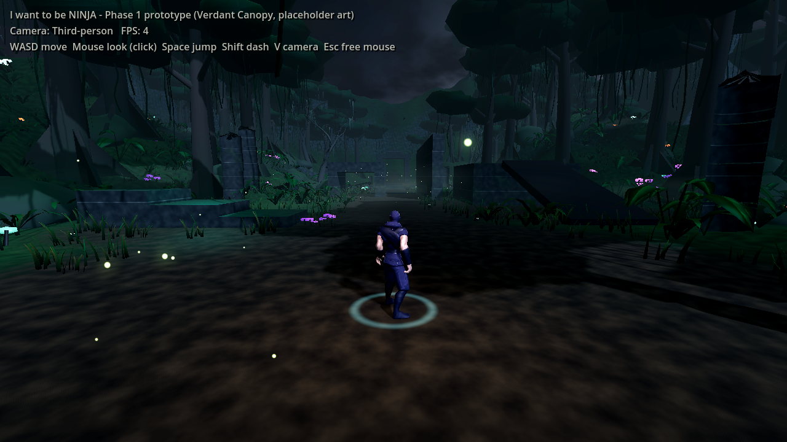

# I want to be NINJA

A 3D jungle ninja hunting adventure for **Android phones and PC**, built in Godot 4.5.

**Status:** Phases 0–11 built: all four jungles — the gloomy Verdant Canopy (Kurogale, the Thornback Stag), volcanic Emberwild (the Ashen Oni-Tortoise), the violet swamp Moonfen (Nami, the Lantern Serpent) and the storm peaks of Stormcrag (Raijin's Echo, the Sky Roc) — with 45:00 expeditions, traversal, twin-blade combat, hazards, breakable boss parts, a dojo forge, original synthesized audio and Low/Medium/High graphics presets. Human playtests pending. See `docs/PHASES.md`.

- How to run it (PC and Android): `project/README.md`
- Controls: `docs/CONTROLS.md`
- Concept art for the 4 jungles: `docs/concept-art/`

---

## Claude Code Starter Kit

A production-minded blueprint for building a third-person / top-down 3D jungle action-adventure sandbox.

## Recommended engine
**Godot 4.5** (GDScript) is the default recommendation for this kit: free, open source, approachable for Claude Code, and capable of stylized high-quality 3D. This kit is a design + development scaffold, not a finished game or a complete asset pack.

## Start
1. Install Godot 4.x (stable) and Claude Code.
2. Extract this folder into a new project directory.
3. Open the folder in Claude Code.
4. Start with `CLAUDE.md`; ask Claude to execute **Phase 0** in `docs/PHASES.md`.
5. Build one small vertical slice before expanding content.

## Game identity
**Title:** I want to be NINJA  
**Genre:** 3D sandbox action-adventure / monster hunt / traversal  
**Core loop:** Explore a jungle → overcome traversal challenges → reach the hunt arena before the 45-minute deadline → defeat a magical beast → break parts → craft/upgrade ninja gear → unlock further hunts.

## Package map
- `CLAUDE.md` — project-wide instructions for Claude Code
- `.claude/agents/` — specialist agent profiles
- `.claude/skills/` — reusable workflow skills
- `docs/` — game design, architecture, content, controls, and phase plan
- `prompts/` — ready-to-use kickoff prompts
- `project/` — the Godot project
- `tools/` — `check.sh` (run all checks) and the one-off scene generator
- `docs/THIRD_PARTY.md` — credits for borrowed agents/rules
- `assets/README.md` — art/audio sourcing and quality guidance

## Scope rule
Do not try to build the entire game in one prompt. Phase progression is milestone-gated. The playable first slice should contain one biome, one route, one boss, basic movement/combat, one part-break reward, and a functioning timer.
